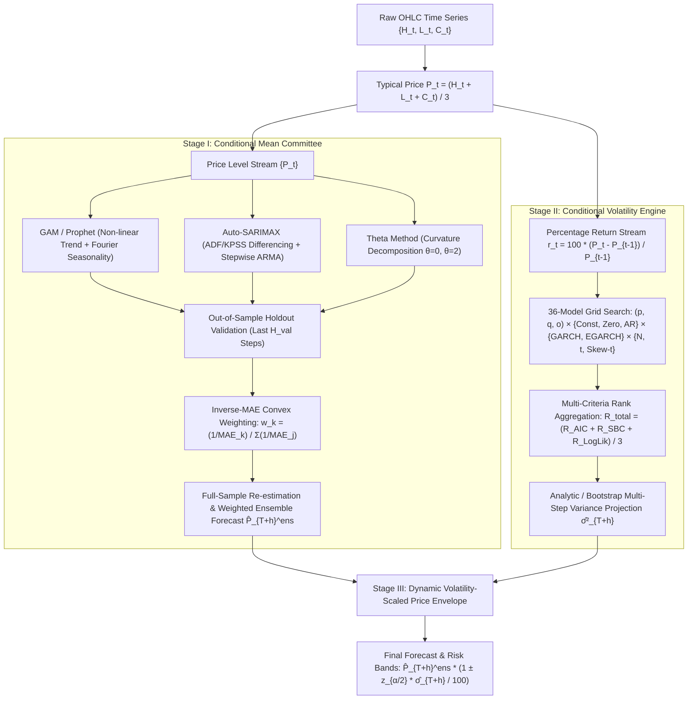

# Hybrid Ensemble Mean and Conditional Volatility Forecasting Methodology

## Abstract

Financial time series exhibit a dual econometric challenge: non-linear, multi-regime dynamics in the conditional mean and time-varying, asymmetric clustering in the conditional variance (heteroskedasticity). Relying on a single parametric specification for point forecasting exposes predictions to structural misspecification, while relying on standard homoskedastic prediction intervals underestimates tail risk during turbulent market regimes. This document presents the mathematical and econometric methodology implemented in the **Garchie** framework (see [weighted_forecast.py](file:///home/andreas/Documents/garchie/Garchie/examples/weighted_forecast.py) and [garchie/models](file:///home/andreas/Documents/garchie/Garchie/garchie/models)). The framework decouples first- and second-moment estimation by combining a performance-weighted committee of three structurally distinct conditional mean models—a Generalized Additive Model (Prophet), an automated Seasonal ARIMA (SARIMAX) process, and the Theta decomposition method—with a grid-optimized Generalized Autoregressive Conditional Heteroskedasticity (GARCH/GJR-GARCH/EGARCH) volatility process. The resulting conditional standard deviation forecasts are projected onto the ensemble mean trajectory to form dynamic, heteroskedasticity-consistent confidence intervals.

---

## 1. Econometric Motivation and Problem Formulation

Let $\{H_t, L_t, C_t\}_{t=1}^T$ denote the observed high, low, and closing prices of a financial asset sampled at discrete, regular intervals $\Delta t$ (daily, weekly, or monthly). To attenuate microstructure noise and closing-auction distortions while preserving intra-period trading range information, the target price series is defined via the **Typical Price** transformation:

$$
P_t = \frac{H_t + L_t + C_t}{3}, \quad t \in \{1, \dots, T\}
$$

While price levels $P_t$ are non-stationary ($I(1)$) and dominated by secular drift, asset risk is governed by the relative dispersion of period-over-period changes. Following standard financial econometrics ([chapter1.pdf](file:///home/andreas/Documents/garchie/Garchie/garchie/theory/chapter1.pdf)), percentage arithmetic returns are defined as:

$$
r_t = 100 \cdot \left( \frac{P_t - P_{t-1}}{P_{t-1}} \right)
$$

Classical time series models that jointly estimate the conditional mean and prediction intervals in price space typically assume homoskedastic Gaussian innovations, $\varepsilon_t \overset{\text{i.i.d.}}{\sim} \mathcal{N}(0, \sigma^2)$. Empirical financial series violate this assumption in three ways ([chapter1.pdf](file:///home/andreas/Documents/garchie/Garchie/garchie/theory/chapter1.pdf); [chapter2.pdf](file:///home/andreas/Documents/garchie/Garchie/garchie/theory/chapter2.pdf)):

1. **Model Instability in the Conditional Mean:** No single functional form uniformly dominates across trending, mean-reverting, and seasonal market regimes.
2. **Volatility Clustering (Conditional Heteroskedasticity):** Large return shocks tend to be followed by large shocks of either sign, causing the conditional variance $\sigma_t^2 = \text{Var}(r_t \mid \mathcal{I}_{t-1})$ to evolve autoregressively over time (Engle, 1982; Bollerslev, 1986).
3. **Leptokurtosis and Leverage Asymmetry:** Empirical return innovations exhibit heavy tails (excess kurtosis) and asymmetric responses where negative price shocks induce larger volatility spikes than positive shocks of equal magnitude (Nelson, 1991; Glosten, Jagannathan, & Runkle, 1993).

To address these properties simultaneously, the Garchie pipeline decomposes the forecasting problem into two orthogonal stages:

---

## 2. Constituent Conditional Mean Models

The conditional mean committee comprises three structurally diverse model families implemented in [garchie/models](file:///home/andreas/Documents/garchie/Garchie/garchie/models). Combining models from distinct mathematical paradigms—semi-parametric additive regression, Box–Jenkins state-space autoregression, and exponential-smoothing curvature decomposition—reduces forecast variance when individual models are subject to specification error (Bates & Granger, 1969; Timmermann, 2006).

### 2.1 Generalized Additive Model (GAM / Prophet)

Implemented in [gam_model.py](file:///home/andreas/Documents/garchie/Garchie/garchie/models/gam_model.py), the GAM formulation follows Taylor & Letham (2018) by decomposing the price trajectory $P(t)$ into an additive regression over continuous time:

$$
P(t) = g(t) + s(t) + \varepsilon_t, \quad \varepsilon_t \sim \mathcal{N}(0, \sigma_\varepsilon^2)
$$

1. **Piecewise Linear Trend $g(t)$:** Captures non-linear secular growth and structural regime shifts via $S$ automatically selected changepoints at times $s_j \in (0, T)$:
   $$
   g(t) = \left( k + \mathbf{a}(t)^\top \boldsymbol{\delta} \right) t + \left( m + \mathbf{a}(t)^\top \boldsymbol{\gamma} \right)
   $$
   where $k$ is the base growth rate, $\boldsymbol{\delta} \in \mathbb{R}^S$ is a vector of rate adjustments regularized under a sparse Laplace prior $\delta_j \sim \text{Laplace}(0, \tau)$, $\mathbf{a}(t) \in \{0,1\}^S$ is a step-indicator vector with $a_j(t) = \mathbb{I}(t \ge s_j)$, and $\gamma_j = -s_j \delta_j$ enforces continuity at each knot.
2. **Fourier Periodic Seasonality $s(t)$:** Models smooth calendar cycles of period $P_s$ (e.g., $P_s = 365.25$ for yearly seasonality or $P_s = 7$ for weekly seasonality) using a truncated Fourier series of order $N$:
   $$
   s(t) = \sum_{n=1}^{N} \left[ a_n \cos\left(\frac{2\pi n t}{P_s}\right) + b_n \sin\left(\frac{2\pi n t}{P_s}\right) \right]
   $$

**Role in the Ensemble:** Unlike ARIMA processes, the GAM does not require differencing to achieve stationarity and is robust to missing observations and structural trend breaks.

---

### 2.2 Seasonal AutoRegressive Integrated Moving Average (SARIMAX)

Implemented in [mean_model.py](file:///home/andreas/Documents/garchie/Garchie/garchie/models/mean_model.py), the autoregressive mean model captures short-run serial correlation and stochastic seasonality following the Box–Jenkins paradigm (Box & Jenkins, 1970) and the automated Hyndman–Khandakar algorithm (Hyndman & Khandakar, 2008).

#### 2.2.1 Dual-Test Integration Order Selection ($d$)
Financial price levels typically contain stochastic trends. Rather than relying on a single unit-root test with low power against near-integrated alternatives, the pipeline evaluates two complementary hypotheses at significance level $\alpha = 0.05$ up to maximum order $d_{\max} = 6$:
- **Augmented Dickey–Fuller (ADF) Test** (Dickey & Fuller, 1979): Tests the null hypothesis $H_0: \text{unit root } I(1)$ against stationarity.
- **KPSS Test** (Kwiatkowski, Phillips, Schmidt, & Shin, 1992): Tests the null hypothesis $H_0: \text{level/trend stationarity } I(0)$ against a unit-root alternative.

To guarantee that the differenced series $\nabla^d P_t = (1 - B)^d P_t$ satisfies stationarity under both testing paradigms, the pipeline selects the conservative upper bound:

$$
d = \max\left( d_{\text{ADF}},\, d_{\text{KPSS}} \right)
$$

#### 2.2.2 Detrended ACF Spectral Periodicity Detection ($m$)
Both [mean_model.py](file:///home/andreas/Documents/garchie/Garchie/garchie/models/mean_model.py) and [theta_model.py](file:///home/andreas/Documents/garchie/Garchie/garchie/models/theta_model.py) infer the dominant seasonal cycle $m$ directly from the empirical autocorrelation structure via `_get_seasonal_period`:
1. **Linear Detrending:** An Ordinary Least Squares (OLS) trend line $\hat{\beta}_0 + \hat{\beta}_1 t$ is subtracted from $P_t$, yielding $\tilde{P}_t = P_t - (\hat{\beta}_0 + \hat{\beta}_1 t)$. This prevents secular drift from dominating low-frequency lags of the Autocorrelation Function (ACF).
2. **FFT Autocorrelation Peak Search:** The sample ACF $\hat{\rho}(k)$ is computed via Fast Fourier Transform up to lag $K = \lfloor T/2 \rfloor$. Lags $k \in \{0, \dots, 4\}$ are excluded so short-horizon autoregressive decay is not misclassified as seasonality:
   $$
   m_{\text{raw}} = \arg\max_{k \in \{5, \dots, \lfloor T/2 \rfloor\}} \hat{\rho}(k)
   $$
3. **Calendar Cycle Quantization:** To prevent sample noise from producing non-physical seasonal periods, $m_{\text{raw}}$ is snapped to canonical financial trading calendars:

| Raw ACF Peak Range ($m_{\text{raw}}$) | Snapped Period ($m$) | Econometric Interpretation |
| :--- | :---: | :--- |
| $4 \le m_{\text{raw}} \le 6$ | $5$ | Business week (daily equity trading) |
| $6 \le m_{\text{raw}} \le 8$ | $7$ | Calendar week (continuous / crypto trading) |
| $11 \le m_{\text{raw}} \le 13$ | $12$ | Annual cycle (monthly sampling) |
| $28 \le m_{\text{raw}} \le 31$ | $30$ | Monthly cycle (daily sampling) |
| $50 \le m_{\text{raw}} \le 54$ | $52$ | Annual cycle (weekly sampling) |
| $360 \le m_{\text{raw}} \le 370$ | $365$ | Annual cycle (daily calendar sampling) |

#### 2.2.3 Multiplicative SARIMAX State-Space Estimation
Given $(d, m)$, the Hyndman–Khandakar stepwise search (`pmdarima.auto_arima`) selects the optimal autoregressive and moving-average orders $(p, d, q) \times (P, D, Q)_m$ ($p, q \le 5$) minimizing the Akaike Information Criterion (AIC). The selected specification is then cast into state-space form via `statsmodels` `SARIMAX`:

$$
\Phi_p(B)\,\tilde{\Phi}_P(B^m)\,(1 - B)^d (1 - B^m)^D P_t = \Theta_q(B)\,\tilde{\Theta}_Q(B^m)\,\eta_t, \quad \eta_t \sim \text{WN}(0, \sigma_\eta^2)
$$

where $B$ is the backshift operator ($B^k P_t = P_{t-k}$), $\Phi_p(B) = 1 - \sum_{i=1}^p \phi_i B^i$, and $\Theta_q(B) = 1 + \sum_{j=1}^q \theta_j B^j$.

---

### 2.3 The Theta Decomposition Method

Implemented in [theta_model.py](file:///home/andreas/Documents/garchie/Garchie/garchie/models/theta_model.py) using `statsmodels.tsa.forecasting.theta.ThetaModel`, the Theta method (Assimakopoulos & Nikolopoulos, 2000) modifies the local curvature of a deseasonalized time series $Y_t$ through a coefficient $\theta \in \mathbb{R}$ applied to its second differences:

$$
Y''_{\theta}(t) = \theta \, Y''(t) = \theta \left( Y_t - 2Y_{t-1} + Y_{t-2} \right), \quad t \ge 3
$$

In the standard two-line decomposition ($\theta_1 = 0, \theta_2 = 2$):
- **The $\theta_1 = 0$ Line:** Zeroes out all second differences ($Y''_0(t) = 0$), reducing the series to a deterministic linear trend $L_t = \hat{\alpha} + \hat{\beta} t$ extrapolated via OLS.
- **The $\theta_2 = 2$ Line:** Doubles the local curvature of the series to accentuate short-term oscillations and is extrapolated via Simple Exponential Smoothing (SES) with smoothing parameter $\alpha_{\text{SES}} \in (0,1)$.

As shown by Hyndman & Billah (2003), an equal-weighted combination of the $\theta_1 = 0$ and $\theta_2 = 2$ forecasts is algebraically equivalent to Simple Exponential Smoothing with a constant drift term equal to half the slope of the linear trend:

$$
\hat{Y}_{T+h \mid T} = \tilde{Y}_T + \frac{1}{2}\hat{\beta} \left( h - 1 + \frac{1}{\alpha_{\text{SES}}} \right)
$$

followed by multiplicative or additive reseasonalization at period $m$.

**Role in the Ensemble:** The Theta model acts as a regularized, low-variance shrinkage estimator that dampens high-order autoregressive overfitting while preserving long-run drift.

---

## 3. Out-of-Sample Validation and Inverse-MAE Forecast Combination

### 3.1 Temporal Hold-Out Partitioning

Let $\mathcal{M} = \{\text{GAM}, \text{ARIMA}, \text{Theta}\}$ denote the set of candidate mean models, and let $H_{\text{val}}$ denote the validation horizon (e.g., $H_{\text{val}} = 12$ weeks in [weighted_forecast.py](file:///home/andreas/Documents/garchie/Garchie/examples/weighted_forecast.py)). The historical sample $\mathcal{D}_{1:T}$ is partitioned chronologically to prevent look-ahead bias ([chapter2.pdf](file:///home/andreas/Documents/garchie/Garchie/garchie/theory/chapter2.pdf); [chapter3.pdf](file:///home/andreas/Documents/garchie/Garchie/garchie/theory/chapter3.pdf)):

$$
\mathcal{D}_{\text{train}} = \{P_t\}_{t=1}^{T - H_{\text{val}}}, \qquad \mathcal{D}_{\text{val}} = \{P_t\}_{t=T - H_{\text{val}} + 1}^{T}
$$

Each model $k \in \mathcal{M}$ is estimated strictly on $\mathcal{D}_{\text{train}}$ and tasked with generating an $H_{\text{val}}$-step out-of-sample trajectory $\left\{\hat{P}_{t \mid T - H_{\text{val}}}^{(k)}\right\}_{t = T - H_{\text{val}} + 1}^{T}$.

### 3.2 Inverse-MAE Convex Weighting Scheme

Forecast accuracy over $\mathcal{D}_{\text{val}}$ is evaluated via the Mean Absolute Error (MAE, [chapter3.pdf](file:///home/andreas/Documents/garchie/Garchie/garchie/theory/chapter3.pdf)):

$$
\text{MAE}_k = \frac{1}{H_{\text{val}}} \sum_{t = T - H_{\text{val}} + 1}^{T} \left| P_t - \hat{P}_{t \mid T - H_{\text{val}}}^{(k)} \right|, \quad k \in \mathcal{M}
$$

Unlike Mean Squared Error (MSE), which squares forecast errors and allows a single extreme market shock in $\mathcal{D}_{\text{val}}$ to dominate weight allocation, MAE measures expected $L_1$ deviation and is more robust to fat-tailed financial innovations. Following the Bates–Granger inverse-error combination principle (Bates & Granger, 1969; Timmermann, 2006), the ensemble weights $w_k$ are computed proportional to the reciprocal of out-of-sample MAE:

$$
\tilde{w}_k = \begin{cases}
\text{MAE}_k^{-1}, & \text{if } \text{MAE}_k > 0 \\
10^6, & \text{if } \text{MAE}_k = 0
\end{cases}, \qquad
w_k = \frac{\tilde{w}_k}{\sum_{j \in \mathcal{M}} \tilde{w}_j}
$$

This guarantees a convex combination ($\sum_{k \in \mathcal{M}} w_k = 1$, $w_k \ge 0$) where models demonstrating superior out-of-sample generalization on the recent regime receive proportionally greater weight.

### 3.3 Full-Sample Adaptive Re-Optimization

A critical methodological choice in all four `design_*_model` pipelines ([gam_model.py](file:///home/andreas/Documents/garchie/Garchie/garchie/models/gam_model.py), [mean_model.py](file:///home/andreas/Documents/garchie/Garchie/garchie/models/mean_model.py), [theta_model.py](file:///home/andreas/Documents/garchie/Garchie/garchie/models/theta_model.py), [garch_model.py](file:///home/andreas/Documents/garchie/Garchie/garchie/models/garch_model.py)) is **full-sample re-optimization** prior to projecting the future horizon $h \in \{1, \dots, H_{\text{fut}}\}$.

> [!IMPORTANT]
> Rather than freezing the structural hyperparameters discovered on $\mathcal{D}_{\text{train}}$ (which ends $H_{\text{val}}$ periods in the past), the pipeline re-executes unit-root tests, ACF seasonality detection, stepwise SARIMA selection, and GARCH grid search on the complete dataset $\mathcal{D}_{1:T}$. In non-stationary financial markets, the final $H_{\text{val}}$ observations carry the highest informational weight regarding current market drift and volatility regimes.

Once each constituent model $k \in \mathcal{M}$ produces its re-estimated future trajectory $\hat{P}_{T+h \mid T}^{(k)}$, the composite ensemble point forecast is formed as:

$$
\hat{P}_{T+h}^{\text{ens}} = w_{\text{GAM}}\,\hat{P}_{T+h \mid T}^{(\text{GAM})} + w_{\text{ARIMA}}\,\hat{P}_{T+h \mid T}^{(\text{ARIMA})} + w_{\text{Theta}}\,\hat{P}_{T+h \mid T}^{(\text{Theta})}, \quad h \in \{1, \dots, H_{\text{fut}}\}
$$

---

## 4. Conditional Volatility Modeling via the ARCH/GARCH Family

To quantify time-varying uncertainty around $\hat{P}_{T+h}^{\text{ens}}$, [garch_model.py](file:///home/andreas/Documents/garchie/Garchie/garchie/models/garch_model.py) models the percentage return series $\{r_t\}_{t=2}^T$ using the `arch` econometric library (Sheppard, 2019; [chapter1.pdf](file:///home/andreas/Documents/garchie/Garchie/garchie/theory/chapter1.pdf)).

### 4.1 Return Decomposition and Innovation Distributions

Returns are decomposed into a conditional mean $\mu_t = \mathbb{E}[r_t \mid \mathcal{I}_{t-1}]$ and a heteroskedastic shock $\epsilon_t$ ([chapter1.pdf](file:///home/andreas/Documents/garchie/Garchie/garchie/theory/chapter1.pdf); [chapter2.pdf](file:///home/andreas/Documents/garchie/Garchie/garchie/theory/chapter2.pdf)):

$$
r_t = \mu_t + \epsilon_t, \qquad \epsilon_t = \sigma_t z_t, \qquad z_t \overset{\text{i.i.d.}}{\sim} D(0, 1)
$$

where $z_t = \epsilon_t / \sigma_t$ denotes the standardized residual and $\sigma_t^2 = \mathbb{E}[\epsilon_t^2 \mid \mathcal{I}_{t-1}]$ is the conditional variance. The grid search evaluates three candidate specifications for the return mean $\mu_t$ ([chapter2.pdf](file:///home/andreas/Documents/garchie/Garchie/garchie/theory/chapter2.pdf)):
- **Constant Mean (`constant`):** $\mu_t = \mu$
- **Zero Mean (`zero`):** $\mu_t = 0$ (appropriate when return drift is negligible or modeled externally)
- **Autoregressive Mean (`AR`):** $\mu_t = \mu + \sum_{i=1}^{k} \phi_i r_{t-i}$

To accommodate heavy tails and return skewness ([chapter2.pdf](file:///home/andreas/Documents/garchie/Garchie/garchie/theory/chapter2.pdf)), three innovation density families $D(0,1)$ are evaluated:
1. **Standard Normal (`normal`):** $f(z_t) = \frac{1}{\sqrt{2\pi}} \exp\left(-z_t^2 / 2\right)$.
2. **Standardized Student's $t$ (`t`):** Parameterized by degrees of freedom $\nu > 2$ to capture symmetric leptokurtosis (fat tails).
3. **Hansen's Skewed Student's $t$ (`skewt`):** Introduced by Hansen (1994), parameterized by tail thickness $\nu > 2$ and asymmetry parameter $\lambda \in (-1, 1)$ to capture negative return skewness common in equity indices.

### 4.2 Symmetric and Asymmetric Variance Specifications

The grid search in [garch_model.py](file:///home/andreas/Documents/garchie/Garchie/garchie/models/garch_model.py) spans lag orders $p = 1$, $q = 1$, and asymmetry order $o \in \{0, 1\}$ across two volatility families:

#### 4.2.1 Standard $\text{GARCH}(p, q)$ ($o = 0$)
Developed by Bollerslev (1986), the symmetric $\text{GARCH}(1,1)$ model expresses conditional variance as a linear combination of the long-run variance weight $\omega$, the lagged squared shock $\epsilon_{t-1}^2$ (ARCH term), and lagged conditional variance $\sigma_{t-1}^2$ (GARCH persistence term):

$$
\sigma_t^2 = \omega + \sum_{i=1}^{p} \alpha_i \epsilon_{t-i}^2 + \sum_{j=1}^{q} \beta_j \sigma_{t-j}^2
$$

Positivity and wide-sense stationarity require $\omega > 0$, $\alpha_i \ge 0$, $\beta_j \ge 0$, and $\alpha_1 + \beta_1 < 1$, under which variance mean-reverts toward the unconditional level $\bar{\sigma}^2 = \frac{\omega}{1 - \alpha_1 - \beta_1}$ ([chapter1.pdf](file:///home/andreas/Documents/garchie/Garchie/garchie/theory/chapter1.pdf)).

#### 4.2.2 Threshold Asymmetric $\text{GJR-GARCH}(p, o, q)$ (`vol='GARCH'`, $o = 1$)
When $o = 1$ with `vol='GARCH'`, `arch_model` estimates the Glosten–Jagannathan–Runkle specification (Glosten et al., 1993; [chapter2.pdf](file:///home/andreas/Documents/garchie/Garchie/garchie/theory/chapter2.pdf)):

$$
\sigma_t^2 = \omega + \sum_{i=1}^{p} \alpha_i \epsilon_{t-i}^2 + \sum_{k=1}^{o} \gamma_k \epsilon_{t-k}^2 \mathbb{I}(\epsilon_{t-k} < 0) + \sum_{j=1}^{q} \beta_j \sigma_{t-j}^2
$$

where $\mathbb{I}(\epsilon_{t-k} < 0) = 1$ if the shock is negative and $0$ otherwise. A positive leverage coefficient ($\gamma_1 > 0$) means negative return shocks have a total marginal impact of $\alpha_1 + \gamma_1$ on next-period variance, compared to $\alpha_1$ for positive shocks.

#### 4.2.3 Exponential GARCH — $\text{EGARCH}(p, o, q)$ (`vol='EGARCH'`)
Introduced by Nelson (1991), $\text{EGARCH}$ models the natural logarithm of conditional variance ([chapter2.pdf](file:///home/andreas/Documents/garchie/Garchie/garchie/theory/chapter2.pdf)):

$$
\ln\left(\sigma_t^2\right) = \omega + \sum_{i=1}^{p} \alpha_i \left( \left|z_{t-i}\right| - \mathbb{E}\left|z_{t-i}\right| \right) + \sum_{k=1}^{o} \gamma_k z_{t-k} + \sum_{j=1}^{q} \beta_j \ln\left(\sigma_{t-j}^2\right)
$$

Because $\sigma_t^2 = \exp(\cdot)$ is strictly positive for any real parameter vector, $\text{EGARCH}$ requires no non-negativity constraints during numerical optimization and captures shock asymmetry directly through the sign of $\gamma_k$.

### 4.3 Multi-Criteria Rank-Aggregation Model Selection

Evaluating the Cartesian product of $(p=1) \times (q=1) \times (o \in \{0,1\}) \times (\text{mean} \in \{\text{constant}, \text{zero}, \text{AR}\}) \times (\text{vol} \in \{\text{GARCH}, \text{EGARCH}\}) \times (\text{dist} \in \{\text{normal}, \text{skewt}, \text{t}\})$ yields $36$ candidate specifications. Each converged candidate $m$ (fitted via Maximum Likelihood with `maxiter=200`) is evaluated on three goodness-of-fit criteria ([chapter3.pdf](file:///home/andreas/Documents/garchie/Garchie/garchie/theory/chapter3.pdf)):

1. **Akaike Information Criterion:** $\text{AIC}_m = -2\ell_m + 2k_m$ (ranked ascending, $R_{\text{AIC}}(m)$).
2. **Schwarz / Bayesian Information Criterion:** $\text{SBC}_m = -2\ell_m + k_m \ln(T)$ (ranked ascending, $R_{\text{SBC}}(m)$, penalizing complexity more heavily than AIC).
3. **Maximized Log-Likelihood:** $\ell_m = \sum_{t} \ln f(r_t \mid \mathcal{I}_{t-1}; \hat{\boldsymbol{\theta}}_m)$ (ranked descending, $R_{\ell}(m)$).

To balance in-sample fit ($\ell_m$) against parsimony penalties ($\text{AIC}_m, \text{SBC}_m$), [garch_model.py](file:///home/andreas/Documents/garchie/Garchie/garchie/models/garch_model.py) selects the model $m^*$ minimizing the composite average rank:

$$
m^* = \arg\min_{m} \, R_{\text{total}}(m), \qquad R_{\text{total}}(m) = \frac{R_{\text{AIC}}(m) + R_{\text{SBC}}(m) + R_{\ell}(m)}{3}
$$

### 4.4 Multi-Step Variance Forecasting: Analytic vs. Bootstrap Recursion

Given the optimal fitted model $m^*$, multi-horizon conditional variance forecasts $\hat{\sigma}_{T+h \mid T}^2$ ($h = 1, \dots, H_{\text{fut}}$) are generated in `_forecast_volatility`:
- **Linear Variance Processes ($\text{GARCH}$, $\text{GJR-GARCH}$):** Because $\sigma_{T+h}^2$ is linear in lagged squared innovations, multi-step forecasts have an exact closed-form analytic recursion.
- **Log-Variance Processes ($\text{EGARCH}$):** Because $\mathbb{E}[\exp(\ln \sigma_{T+h}^2) \mid \mathcal{I}_T] \neq \exp(\mathbb{E}[\ln \sigma_{T+h}^2 \mid \mathcal{I}_T])$ for $h > 1$ due to Jensen's inequality, closed-form analytic multi-step forecasts do not exist. The pipeline therefore uses **empirical residual bootstrap** (`method="bootstrap"`), resampling historical standardized residuals $\hat{z}_t = \hat{\epsilon}_t / \hat{\sigma}_t$ to simulate multi-step paths, with automatic fallback to parametric Monte Carlo simulation (`method="simulation"`) if bootstrap convergence fails.

The forecasted conditional volatility (in percentage return units per period) is obtained via the square-root transformation:

$$
\hat{\sigma}_{T+h} = \sqrt{\hat{\sigma}_{T+h \mid T}^2}
$$

---

## 5. Synthesizing the Hybrid Mean–Volatility Prediction Interval

The final step in [weighted_forecast.py](file:///home/andreas/Documents/garchie/Garchie/examples/weighted_forecast.py#L121-L148) bridges the conditional mean committee and the conditional volatility engine to construct dynamic risk-adjusted confidence bands in price space.

### 5.1 From Dynamic VaR in Return Space to Price Envelopes

In financial risk management ([chapter4.pdf](file:///home/andreas/Documents/garchie/Garchie/garchie/theory/chapter4.pdf)), the forward-looking parametric Value-at-Risk ($\text{VaR}$) or return quantile at horizon $T+h$ and confidence level $1 - \alpha$ is given by:

$$
q_{1-\alpha}\left(r_{T+h} \mid \mathcal{I}_T\right) = \hat{\mu}_{T+h} \pm z_{1 - \alpha/2} \cdot \hat{\sigma}_{T+h}
$$

where $z_{1-\alpha/2} = \Phi^{-1}(1 - \alpha/2)$ is the two-sided standard normal critical value ($z_{0.975} = 1.96$ for a $95\%$ interval, $\alpha = 0.05$).

In the Garchie hybrid architecture, the expected price trajectory is already anchored by the multi-model ensemble point forecast $\hat{P}_{T+h}^{\text{ens}}$ rather than the single-equation return mean $\hat{\mu}_{T+h}$. Mapping a relative return fluctuation of $\pm z_{1-\alpha/2} \cdot (\hat{\sigma}_{T+h} / 100)$ around the ensemble price level $\hat{P}_{T+h}^{\text{ens}}$ yields the multiplicative **GARCH Volatility Price Envelope**:

$$
\text{Lower CI}_{T+h}^{(1-\alpha)} = \hat{P}_{T+h}^{\text{ens}} \cdot \left( 1 - z_{1-\alpha/2} \cdot \frac{\hat{\sigma}_{T+h}}{100} \right)
$$

$$
\text{Upper CI}_{T+h}^{(1-\alpha)} = \hat{P}_{T+h}^{\text{ens}} \cdot \left( 1 + z_{1-\alpha/2} \cdot \frac{\hat{\sigma}_{T+h}}{100} \right)
$$

Both the out-of-sample validation trajectory ($t \in [T - H_{\text{val}} + 1, T]$) and the future forecast trajectory ($T+h, \, h \in [1, H_{\text{fut}}]$) are equipped with this dynamic envelope, allowing visual and quantitative verification of interval calibration during validation before projecting forward.

### 5.2 Methodological Properties and Theoretical Remarks

1. **Regime-Adaptive Interval Width:** During low-volatility regimes, $\hat{\sigma}_{T+h}$ contracts and produces tight decision boundaries around $\hat{P}_{T+h}^{\text{ens}}$. Following a market shock or drawdown, GARCH persistence ($\beta_1$) and leverage asymmetry ($\gamma_1$) automatically widen the price envelope to reflect heightened conditional risk, gradually mean-reverting toward the unconditional volatility $\bar{\sigma}$ as $h \to \infty$.
2. **Scale Invariance (Multiplicative Fan):** Because $\hat{\sigma}_{T+h}/100$ scales proportionally with $\hat{P}_{T+h}^{\text{ens}}$, the dollar width of the confidence interval $2 \cdot z_{1-\alpha/2} \cdot \hat{P}_{T+h}^{\text{ens}} \cdot (\hat{\sigma}_{T+h}/100)$ naturally expands or contracts with the forecasted price level, respecting the geometric nature of asset prices and preventing negative lower bounds for $\hat{\sigma}_{T+h} < 100 / z_{1-\alpha/2}$.
3. **Single-Period vs. Cumulative Horizon Interpretation:** Note that $\hat{\sigma}_{T+h}$ represents the conditional *one-period* return volatility forecasted for period $T+h$. Consequently, the envelope $\hat{P}_{T+h}^{\text{ens}} (1 \pm z_{1-\alpha/2}\hat{\sigma}_{T+h}/100)$ characterizes the expected **period-specific volatility regime** around the consensus price path at step $T+h$ (analogous to a forward-projected Bollinger or conditional VaR band), rather than an unbounded random-walk diffusion cone that grows at rate $\sqrt{h}$.
4. **Potential Extensions (Tail Quantiles):** As detailed in [chapter4.pdf](file:///home/andreas/Documents/garchie/Garchie/garchie/theory/chapter4.pdf), when the rank-selected GARCH specification adopts a Student's $t$ or Skewed-$t$ innovation density, the Gaussian critical value $z_{1-\alpha/2} = 1.96$ can be replaced by either the parametric distribution quantile $q_{\alpha/2}(\hat{\nu}, \hat{\lambda})$ (`model.distribution.ppf`) or the empirical quantile of the standardized residuals $\hat{z}_t = \hat{\epsilon}_t / \hat{\sigma}_t$ to produce asymmetric, fat-tail-adjusted VaR envelopes.

---

## 6. Summary of Pipeline Equations

| Pipeline Stage | Mathematical Formulation | Implementation Reference |
| :--- | :--- | :--- |
| **Typical Price** | $P_t = \frac{1}{3}(H_t + L_t + C_t)$ | [weighted_forecast.py](file:///home/andreas/Documents/garchie/Garchie/examples/weighted_forecast.py#L38) |
| **Percentage Return** | $r_t = 100 \cdot \frac{P_t - P_{t-1}}{P_{t-1}}$ | [weighted_forecast.py](file:///home/andreas/Documents/garchie/Garchie/examples/weighted_forecast.py#L39) |
| **GAM (Prophet)** | $\hat{P}_t^{(\text{GAM})} = g(t) + s(t)$ | [gam_model.py](file:///home/andreas/Documents/garchie/Garchie/garchie/models/gam_model.py#L71-L154) |
| **SARIMAX** | $\Phi_p(B)\tilde{\Phi}_P(B^m)\nabla^d \nabla_m^D P_t = \Theta_q(B)\tilde{\Theta}_Q(B^m)\eta_t$ | [mean_model.py](file:///home/andreas/Documents/garchie/Garchie/garchie/models/mean_model.py#L95-L234) |
| **Theta Method** | $\hat{Y}_{T+h}^{(\text{Theta})} = \frac{1}{2}\left(\hat{Y}_{T+h}^{(\theta=0)} + \hat{Y}_{T+h}^{(\theta=2)}\right)$ | [theta_model.py](file:///home/andreas/Documents/garchie/Garchie/garchie/models/theta_model.py#L84-L179) |
| **Validation Weights** | $w_k = \frac{\text{MAE}_k^{-1}}{\sum_{j \in \mathcal{M}} \text{MAE}_j^{-1}}$ | [weighted_forecast.py](file:///home/andreas/Documents/garchie/Garchie/examples/weighted_forecast.py#L94-L110) |
| **Ensemble Mean** | $\hat{P}_{T+h}^{\text{ens}} = \sum_{k \in \mathcal{M}} w_k \hat{P}_{T+h \mid T}^{(k)}$ | [weighted_forecast.py](file:///home/andreas/Documents/garchie/Garchie/examples/weighted_forecast.py#L143) |
| **GARCH Rank Score** | $R_{\text{total}}(m) = \frac{1}{3}\left(R_{\text{AIC}}(m) + R_{\text{SBC}}(m) + R_{\ell}(m)\right)$ | [garch_model.py](file:///home/andreas/Documents/garchie/Garchie/garchie/models/garch_model.py#L230-L234) |
| **GARCH Price CI** | $\text{CI}_{T+h}^{(0.95)} = \hat{P}_{T+h}^{\text{ens}} \left(1 \pm 1.96 \cdot \frac{\hat{\sigma}_{T+h}}{100}\right)$ | [weighted_forecast.py](file:///home/andreas/Documents/garchie/Garchie/examples/weighted_forecast.py#L145-L147) |

---

## 7. References

### Project Theoretical Materials
1. **Yang, C.** *GARCH Models in Python — Chapter 1: GARCH Model Fundamentals*. Local course material: [chapter1.pdf](file:///home/andreas/Documents/garchie/Garchie/garchie/theory/chapter1.pdf).
2. **Yang, C.** *GARCH Models in Python — Chapter 2: GARCH Model Configuration (Distributions, Mean Specifications, Asymmetric Shocks & Rolling Windows)*. Local course material: [chapter2.pdf](file:///home/andreas/Documents/garchie/Garchie/garchie/theory/chapter2.pdf).
3. **Yang, C.** *GARCH Models in Python — Chapter 3: Model Performance Evaluation (Significance Testing, Ljung-Box, AIC/BIC & Backtesting)*. Local course material: [chapter3.pdf](file:///home/andreas/Documents/garchie/Garchie/garchie/theory/chapter3.pdf).
4. **Yang, C.** *GARCH Models in Python — Chapter 4: GARCH in Action (Dynamic Value at Risk, Dynamic Covariance & Portfolio Beta)*. Local course material: [chapter4.pdf](file:///home/andreas/Documents/garchie/Garchie/garchie/theory/chapter4.pdf).

### Econometric and Forecasting Literature
5. **Assimakopoulos, V., & Nikolopoulos, K.** (2000). The theta model: a decomposition approach to forecasting. *International Journal of Forecasting*, 16(4), 521–530.
6. **Bates, J. M., & Granger, C. W. J.** (1969). The combination of forecasts. *Operational Research Quarterly (Journal of the Operational Research Society)*, 20(4), 451–468.
7. **Bollerslev, T.** (1986). Generalized autoregressive conditional heteroskedasticity. *Journal of Econometrics*, 31(3), 307–327.
8. **Box, G. E. P., & Jenkins, G. M.** (1970). *Time Series Analysis: Forecasting and Control*. Holden-Day, San Francisco.
9. **Dickey, D. A., & Fuller, W. A.** (1979). Distribution of the estimators for autoregressive time series with a unit root. *Journal of the American Statistical Association*, 74(366a), 427–431.
10. **Engle, R. F.** (1982). Autoregressive conditional heteroscedasticity with estimates of the variance of United Kingdom inflation. *Econometrica*, 50(4), 987–1007.
11. **Glosten, L. R., Jagannathan, R., & Runkle, D. E.** (1993). On the relation between the expected value and the volatility of the nominal excess return on stocks. *The Journal of Finance*, 48(5), 1779–1801.
12. **Hansen, B. E.** (1994). Autoregressive conditional density estimation. *International Economic Review*, 35(3), 705–730.
13. **Hyndman, R. J., & Billah, B.** (2003). Unmasking the Theta method. *International Journal of Forecasting*, 19(2), 287–290.
14. **Hyndman, R. J., & Khandakar, Y.** (2008). Automatic time series forecasting: the forecast package for R. *Journal of Statistical Software*, 27(3), 1–22.
15. **Kwiatkowski, D., Phillips, P. C. B., Schmidt, P., & Shin, Y.** (1992). Testing the null hypothesis of stationarity against the alternative of a unit root. *Journal of Econometrics*, 54(1–3), 159–178.
16. **Nelson, D. B.** (1991). Conditional heteroskedasticity in asset returns: A new approach. *Econometrica*, 59(2), 347–370.
17. **Sheppard, K.** (2019). *bashtage/arch: Financial Econometrics for Python*. Zenodo. https://doi.org/10.5281/zenodo.2613877.
18. **Taylor, S. J., & Letham, B.** (2018). Forecasting at scale. *The American Statistician*, 72(1), 37–45.
19. **Timmermann, A.** (2006). Forecast combinations. In G. Elliott, C. W. J. Granger, & A. Timmermann (Eds.), *Handbook of Economic Forecasting* (Vol. 1, pp. 135–196). Elsevier.
